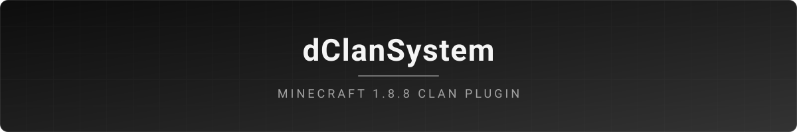

<p align="center">
  
</p>

<p align="center">
  <a href="https://github.com/diogocorreadcs/dClanSystem" target="_blank">
    
  </a>
  <a href="https://getbukkit.org/download/spigot" target="_blank">
    
  </a>
  <a href="https://www.java.com/" target="_blank">
    
  </a>
  <a href="LICENSE" target="_blank">
    
  </a>
</p>

---

### Sobre o Projeto

O **dClanSystem** é um sistema de clãs modular, otimizado e de código aberto para servidores de Minecraft 1.8.8. Desenvolvido com foco em performance e organização estrutural limpa (MVC), o plugin entrega uma experiência fluida para gerenciamento de equipes, comunicação privada, bases compartilhadas, rankings e integração completa com as principais ferramentas do ecossistema.

---

### Funcionalidades

<table align="center" width="100%">
  <tr>
    <td align="center" width="33%" valign="top">
      <b>Gestão & GUIs</b><br><br>
      • Criação e desfazimento de clãs<br>
      • Menus gráficos interativos<br>
      • Convites e controle de membros
    </td>
    <td align="center" width="33%" valign="top">
      <b>Comunicação & Base</b><br><br>
      • Canal de chat exclusivo (`/cc`)<br>
      • Home compartilhada do clã (`/clan h`)<br>
      • Histórico de logs administrativos
    </td>
    <td align="center" width="33%" valign="top">
      <b>Integrações & Rankings</b><br><br>
      • Suporte a Vault, WorldGuard, etc.<br>
      • PlaceholderAPI para tags e Placeholders<br>
      • Ranking dinâmico de clãs (`/clan top`)
    </td>
  </tr>
</table>

---

### Comandos & Permissões

<table align="center" width="100%">
  <tr>
    <td align="left"><b>Comando</b></td>
    <td align="left"><b>Descrição</b></td>
    <td align="left"><b>Permissão Padrão</b></td>
  </tr>
  <tr>
    <td><code>/clan</code> (<code>/clans</code>)</td>
    <td>Comando principal e gerenciamento por GUI</td>
    <td><code>dclansystem.command.accept</code> (Geral)</td>
  </tr>
  <tr>
    <td><code>/clan criar &lt;tag&gt; &lt;nome&gt;</code></td>
    <td>Cria um novo clã</td>
    <td><code>dclansystem.command.create</code></td>
  </tr>
  <tr>
    <td><code>/clan info</code></td>
    <td>Exibe informações detalhadas do clã</td>
    <td><code>dclansystem.command.info</code></td>
  </tr>
  <tr>
    <td><code>/clan convidar &lt;jogador&gt;</code></td>
    <td>Envia um convite para um jogador</td>
    <td><code>dclansystem.command.invite</code></td>
  </tr>
  <tr>
    <td><code>/clan aceitar</code></td>
    <td>Aceita um convite pendente</td>
    <td><code>dclansystem.command.accept</code></td>
  </tr>
  <tr>
    <td><code>/clan sair</code></td>
    <td>Sai do clã atual</td>
    <td><code>dclansystem.command.leave</code></td>
  </tr>
  <tr>
    <td><code>/clan deletar</code></td>
    <td>Desfaz o clã (Apenas líder)</td>
    <td><code>dclansystem.command.disband</code></td>
  </tr>
  <tr>
    <td><code>/clan log</code></td>
    <td>Consulta o histórico de atividades do clã</td>
    <td><code>dclansystem.command.log</code></td>
  </tr>
  <tr>
    <td><code>/clan h</code> (ou <code>/clan base</code>)</td>
    <td>Teleporta para a home do clã</td>
    <td><code>dclansystem.command.home</code></td>
  </tr>
  <tr>
    <td><code>/clan sethome</code></td>
    <td>Define a localização da base do clã</td>
    <td><code>dclansystem.command.sethome</code></td>
  </tr>
  <tr>
    <td><code>/clan top</code></td>
    <td>Exibe o ranking dos clãs</td>
    <td><code>dclansystem.command.top</code></td>
  </tr>
  <tr>
    <td><code>/cc [mensagem]</code></td>
    <td>Alterna ou envia mensagem no chat do clã</td>
    <td><code>dclansystem.command.chat</code></td>
  </tr>
</table>

---

### Arquitetura

O projeto segue rigorosamente os padrões de separação de responsabilidades (MVC):

```text
com.diogocorreadcs.clansystem/
│
├── commands/         # Executores de comandos (/clan, /cc)
├── integrations/     # Hooks externos (Vault, PlaceholderAPI)
├── listeners/        # Ouvintes de eventos e interações
├── managers/         # Regras de negócio e gerenciamento
├── menus/            # Interfaces gráficas (GUIs)
├── models/           # Classes de modelo de dados
├── utils/            # Ferramentas auxiliares e construtores
└── ClanSystem.java   # Classe principal do plugin
```

---

### Contribuição

Este é um projeto Open Source. Sinta-se à vontade para abrir pull requests, reportar problemas ou sugerir melhorias no repositório.
